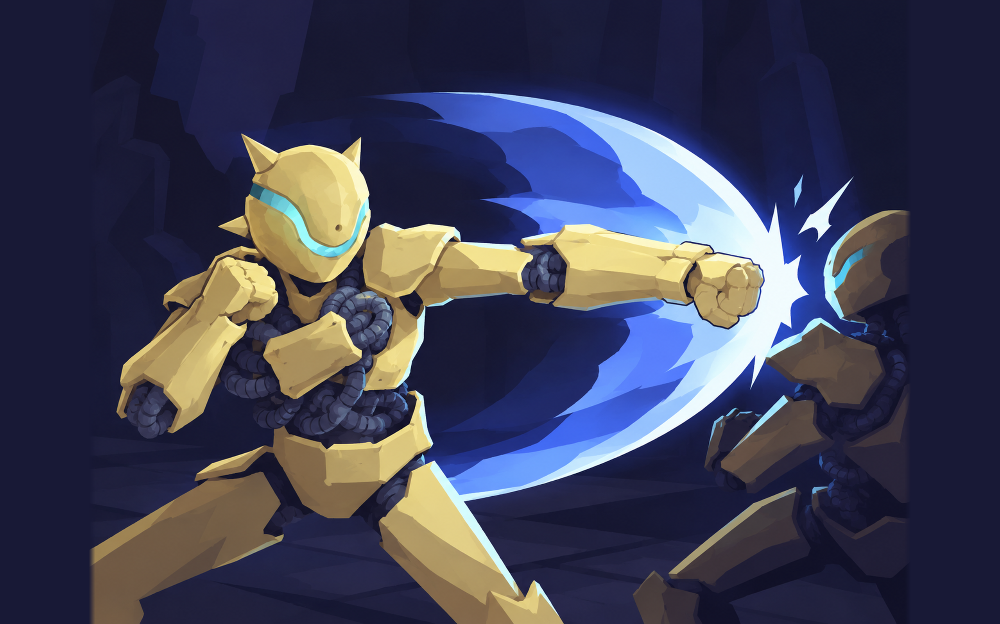
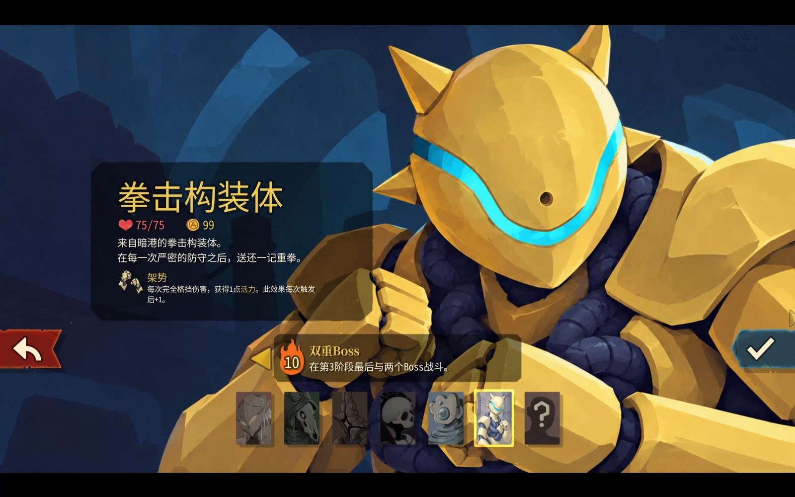
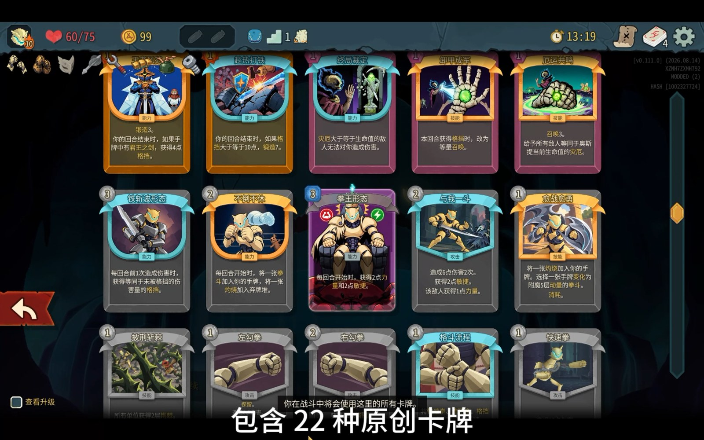
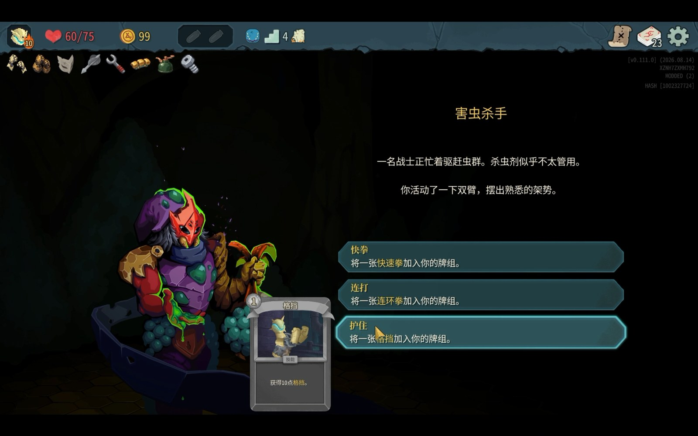

# PunchConstruct

拳击构装体：本质铁斩波，一个《杀戮尖塔 2》角色模组。把暗港「重拳出击」里的拳击构装体做成可用角色，围绕「完全格挡、积累活力、反击成长」设计。

当前版本 **0.5.2**，适配游戏 **0.114.0** 与 **BaseLib 3.4.8**。



## 角色特色

- **完全格挡**：用格挡覆盖伤害，稳稳站住回合。
- **活力**：积累活力，把防守转化为下一击的力量。
- **反击成长**：挨打、格挡、反击，越战越强。
- 开放 0—10 难度，保留玩家自己选择的难度；多人混组时保留原版队友的难度上限。
- 动态选人界面、分层循环海报与选人语音。



## 内容

### 卡牌

**98 种卡牌**：70 张原版搬运牌、1 张铁斩波改版、23 张原创设计、4 种初始牌。锻造、召唤、灾厄等体系有新的搭配，同体系卡牌也更容易凑齐。

新增 10 张愚者搬运牌，沿用原版箭矢机制。其中呼哨箭矢、钉住、火力掩护、啾就绪要先获得蹒跚射击或绽放射击才会出现；欣喜若狂、火力掩护仅多人联机。



### 遗物、能力与先古

**9 件角色专属遗物**，其中 7 件全新美术；另为 28 件原版遗物做了仅对本角色生效的适配，原版角色不受影响。另有 **19 种自定义能力**、**10 枚状态栏图标**。

**9 位先古各 3 组专属对白**，共 27 组；另有建筑师特殊对白 3 组。

### 事件

**5 个事件**有专属文本与效果调整：重拳出击、害虫杀手、螺旋漩涡、融合者、被寄生的自动机械。事件正文会按角色改写，选项也会给出本角色专属的卡牌与效果。



「融合者」会围绕铁斩波改写选项，把牌组里的斩波牌变成更高阶的形态。


### 模式与联机

支持标准、极速（Blitz）与恐惧（Dread）模式；难度上限会按模式调整，多人大厅同步。

本模组支持多人联机，非主机玩家也能正常出牌与结算。联机时建议双方使用相同的游戏版本与模组版本。


## 安装

需要 [BaseLib](https://steamcommunity.com/sharedfiles/filedetails/?id=3737335127) 3.4.8。

- **Steam 创意工坊**：条目 [3826907330](https://steamcommunity.com/sharedfiles/filedetails/?id=3826907330)。订阅后在游戏模组管理中启用。Steam 版本的更新可能稍晚于 GitHub Releases。
- **GitHub 下载**：从 [Releases](https://github.com/zimi1695/PunchConstruct/releases) 下载最新的 `PunchConstruct-0.5.2.zip`，解压后把 `PunchConstruct.dll`、`PunchConstruct.pck`、`PunchConstruct.json` 放进 `游戏目录/mods/PunchConstruct`。
- 在游戏模组管理中同时启用本模组与 BaseLib。
- 手动安装与创意工坊订阅请二选一，不要同时保留两份副本。

## 兼容性

- 主要适配游戏 **0.114.0**。
- 需要 **BaseLib 3.4.8**。
- 游戏 0.113.x 保留兼容代码，但未做完整旧版回归；推荐使用 0.114.0。
- 支持简体中文与英文；其他官方语言回退英文。
- 与 RitsuLib、随机数预测等会改动卡牌播放的模组做了兼容处理。

## 从源码构建

需要 .NET 9 SDK、PowerShell 与 Python 3（依赖见 `tools/README.md`）。

```powershell
.\tools\build.ps1
python tools\package.py --configuration Release
python tools\workshop.py --prepare
```

`tools/package.py` 把源码与资源打成 `.pck`，输出到 `dist/PunchConstruct`；`workshop.py --prepare` 生成工坊目录 `dist/SteamWorkshop`。

## 素材来源

- 《杀戮尖塔》系列的原版角色、卡牌与素材归 Mega Crit 所有。
- 选入的观者卡面及状态图标取自 Boninall 的 [「观者 Watcher」模组](https://steamcommunity.com/sharedfiles/filedetails/?id=3747526116)（0.10.3）。
- 部分原创美术采用 AI 辅助生成。

## 声明

本模组为免费、非官方社区作品，与 Mega Crit 无隶属关系。

本仓库的代码以 [MIT 许可证](LICENSE) 发布；上文列出的 Mega Crit 原版素材、Boninall 的观者素材及其他第三方资源不在该许可范围内，其权利归各自所有者。
