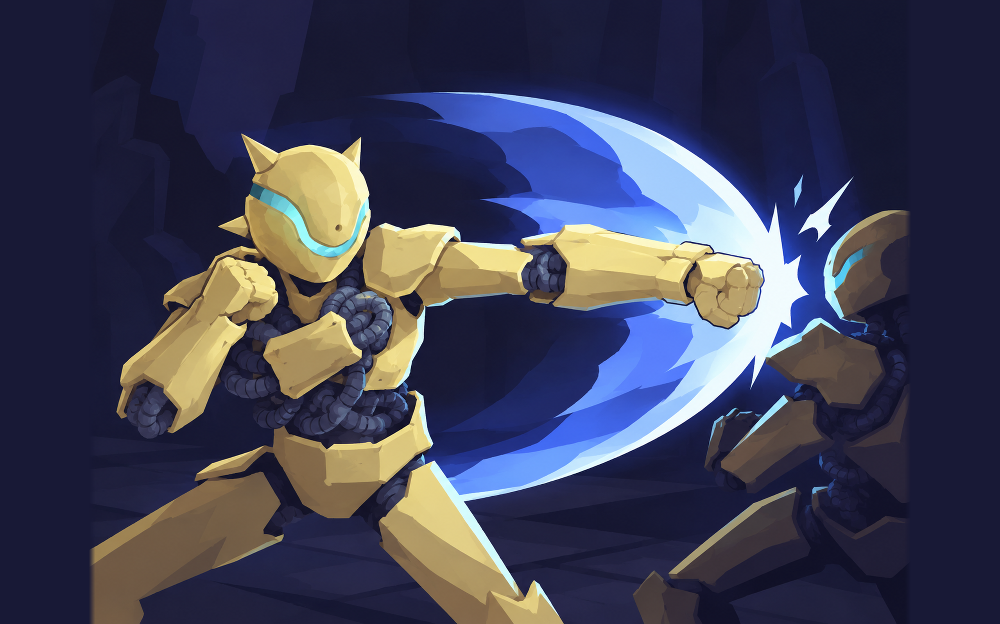
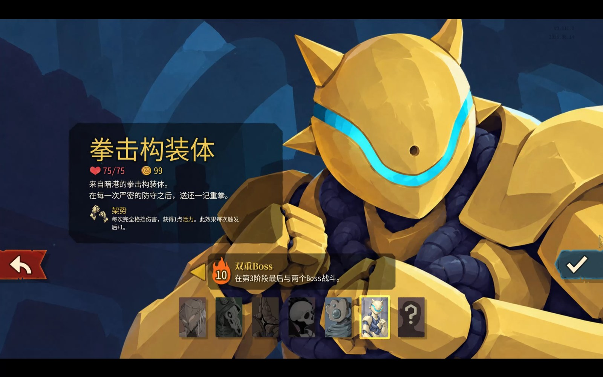
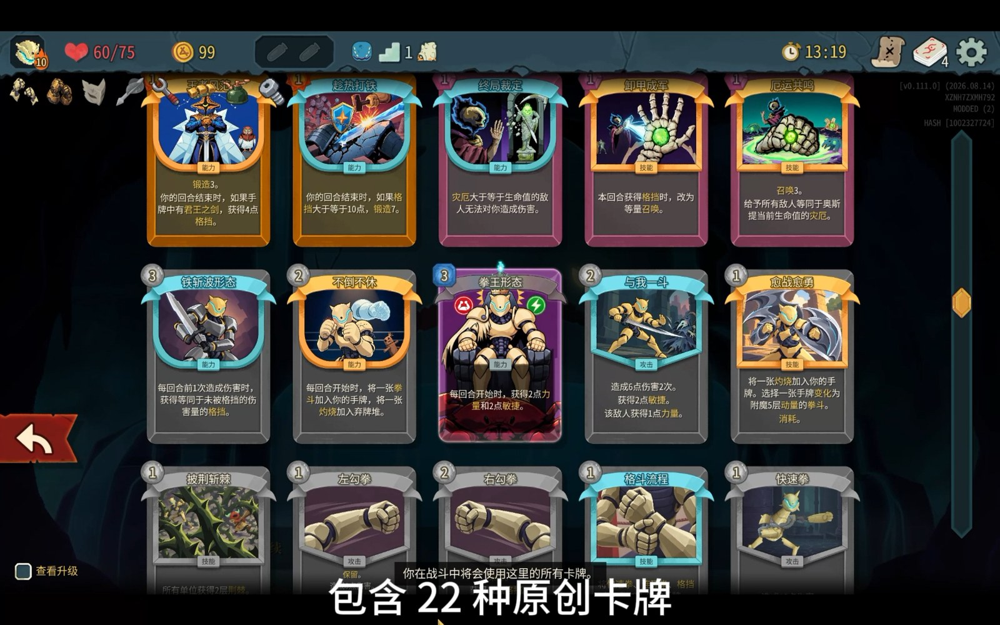
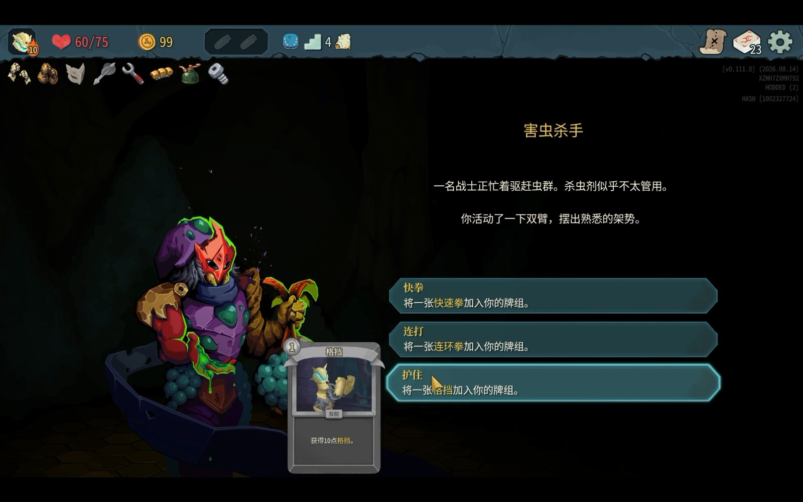
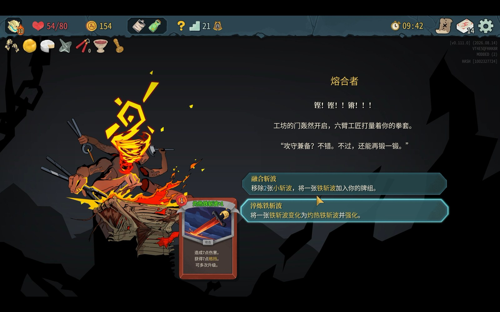
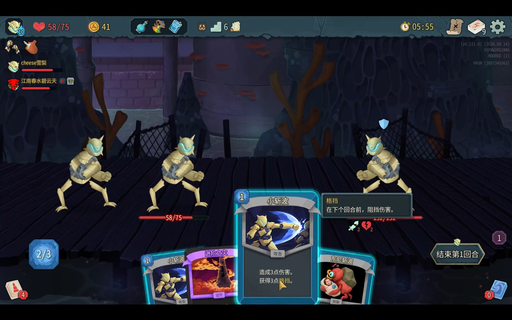
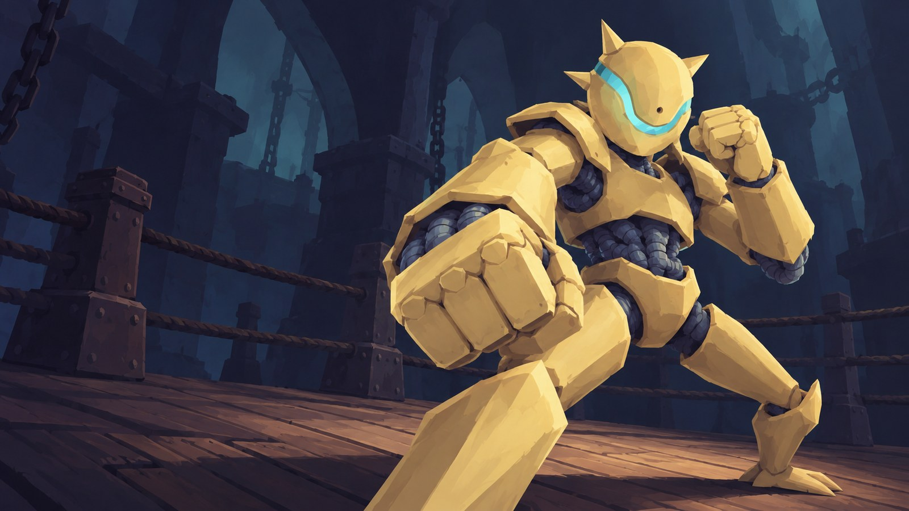

# PunchConstruct

拳击构装体：本质铁斩波，一个《杀戮尖塔 2》角色模组。把暗港「重拳出击」里的拳击构装体做成可用角色，围绕「完全格挡、积累活力、反击成长」设计。

当前版本 **0.4.28**，试玩版；支持简体中文与英文，英文术语复用游戏官方本地化。



## 内容

安装后角色开放全部难度（0—10），保留玩家选择的难度；多人混组时保留原版队友的难度限制。角色沿用原版拳击构装体骨骼，自绘 44 份源图，包含动态选人界面、分层循环海报与选人语音。



### 卡牌

**82 种卡牌**：58 张原版搬运牌、1 张铁斩波改版、22 张原创设计、4 种初始牌。锻造、召唤、灾厄等体系有新的搭配，同体系卡牌更容易凑齐。



### 遗物、能力与先古

**8 件角色专属遗物**，其中 6 件全新美术；另为 28 件原版遗物做了仅对本角色生效的适配，原版角色不受影响。另有 **17 种自定义能力**、**10 枚状态栏图标**。

**9 位先古各 3 组专属对白**，共 27 组；另有建筑师特殊对白 3 组。

### 事件

**4 个事件**有专属文本与效果调整：重拳出击、害虫杀手、螺旋漩涡、融合者。事件正文会按角色改写，选项也会给出本角色专属的卡牌与效果。



「融合者」会围绕铁斩波改写选项，把牌组里的斩波牌变成更高阶的形态。



## 安装

需要 [BaseLib](https://steamcommunity.com/sharedfiles/filedetails/?id=3737335127)（已验证 3.4.7）。

- **Steam 创意工坊**：条目 [3826907330](https://steamcommunity.com/sharedfiles/filedetails/?id=3826907330)。已公开，可直接订阅。
- **手动安装**：把 `PunchConstruct.dll`、`PunchConstruct.pck`、`PunchConstruct.json` 放进 `游戏目录/mods/PunchConstruct`，在游戏模组管理中启用本模组与 BaseLib。

本模组支持多人联机，非主机玩家也能正常出牌与结算。



## 从源码构建

需要 .NET 9 SDK、PowerShell 与 Python 3（依赖见 `tools/README.md`）。

```powershell
.\tools\build.ps1
python tools\package.py --configuration Release
python tools\workshop.py --prepare
```

`tools/package.py` 把源码与资源打成 `.pck`，输出到 `dist/PunchConstruct`；`workshop.py --prepare` 生成工坊目录 `dist/SteamWorkshop`。

本机离线试玩可双击 `TryPrototype.cmd`，启动器会同步最新的 Release 构建，使用隔离存档，不影响正常游戏存档。

## 仓库结构

| 位置 | 内容 |
|---|---|
| `PunchConstruct/` | 模组源码（C# / .NET 9）与游戏资源 |
| `tools/` | 构建、打包、验收脚本与 QA 探针 |
| `dist/SteamWorkshop/` | 工坊配置、封面与宣传预览；`content/` 与 `验收日志/` 为本地构建产物，不入库 |
| `资料/` | 卡牌清单、角色设计、对白、美术源图与开发记录 |

## 验证

发布前在本机通过 35 项功能专项（新增兼容性仿真、英文与多语言回退验收）、4 项断线恢复、4 项联机场景（含 4 人弱网），报告按 16 条不变量归并，未覆盖轴见 `tools/invariants.json`；运行环境为 Windows、游戏 0.111.0。跨机器联机、Steam 邀请与热重连尚未验证。



## 素材来源

- 《杀戮尖塔》系列的原版角色、卡牌与素材归 Mega Crit 所有。
- 选入的观者卡面及状态图标取自 Boninall 的 [「观者 Watcher」模组](https://steamcommunity.com/sharedfiles/filedetails/?id=3747526116)（0.10.3）。
- 部分原创美术采用 AI 辅助生成。

## 声明

本模组为免费、非官方社区作品，与 Mega Crit 无隶属关系。

本仓库的代码以 [MIT 许可证](LICENSE) 发布；上文列出的 Mega Crit 原版素材、Boninall 的观者素材及其他第三方资源不在该许可范围内，其权利归各自所有者。
